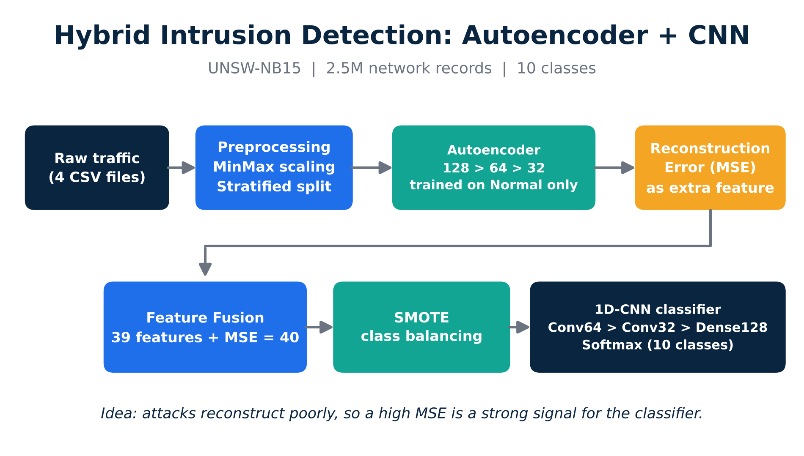

# IDS-Project
Hybrid network intrusion detection on UNSW-NB15: Autoencoder reconstruction-error feature fusion + SMOTE + 1D-CNN (10-class classification
# Hybrid Network Intrusion Detection: Autoencoder + 1D-CNN

Multi-class network intrusion detection on **UNSW-NB15**, combining an Autoencoder's reconstruction error as an extra feature with SMOTE balancing and a 1D-CNN classifier.

## Idea

An Autoencoder is trained **only on normal traffic**, so it reconstructs normal samples well and attacks poorly. The reconstruction error (MSE) is added to the original 39 features as a 40th feature ("MSE feature fusion"), giving the classifier a direct anomaly signal.

## Dataset

- **UNSW-NB15**, 4 CSV files, 2,540,047 records, 43 columns
- 10 classes: Normal + 9 attack types (Fuzzers, Analysis, Backdoors, DoS, Exploits, Generic, Reconnaissance, Shellcode, Worms)
- After cleaning: train 761,042 / test 326,161 samples (39 features), stratified 70/30 split, seed 42
- The data is not included in this repo. See [data/README.md](data/README.md).

## Pipeline

1. Preprocessing: MinMax scaling, stratified split
2. Autoencoder (128 → 64 → 32 → 64 → 128), trained on Normal traffic only
3. Compute per-sample reconstruction error (MSE) and append it as a feature (39 + 1 = 40)
4. SMOTE oversampling of the training set (761,042 → 7,454,920 rows)
5. 1D-CNN: Conv1D(64) → Conv1D(32) → Flatten → Dense(128) → Dropout(0.3) → Softmax(10)
6. Training: 25 epochs, batch size 512, Adam

## Results

| Metric | Value |
|---|---|
| Accuracy | **99.15%** |
| Weighted F1 | 0.99 |
| Macro F1 | **0.51** |

| Class | Precision | Recall | F1 | Support |
|---|---|---|---|---|
| Normal | 1.00 | 1.00 | 1.00 | 319,496 |
| Generic | 0.96 | 0.95 | 0.96 | 2,257 |
| Reconnaissance | 0.82 | 0.79 | 0.80 | 528 |
| Exploits | 0.72 | 0.72 | 0.72 | 1,623 |
| Fuzzers | 0.54 | 0.75 | 0.63 | 1,515 |
| Shellcode | 0.44 | 0.22 | 0.30 | 67 |
| Worms | 1.00 | 0.14 | 0.25 | 7 |
| DoS | 0.28 | 0.17 | 0.21 | 350 |
| Analysis | 0.08 | 0.31 | 0.13 | 158 |
| Backdoors | 0.08 | 0.20 | 0.11 | 160 |

## Limitations

- Overall accuracy is inflated: about 98% of the test set is Normal traffic. Macro F1 (0.51) is the more honest metric.
- Rare classes (Analysis, Backdoors, DoS, Worms, Shellcode) remain weak. Several are confused with each other and with Exploits.
- Worms has only 7 test samples, so its metrics are statistically unreliable.
- SMOTE balances the training set only; the test set keeps its real distribution.

## Future work

- Cost-sensitive learning and focal loss for rare attack classes
- Per-class threshold tuning
- Comparing against baselines without the MSE feature (ablation)

1. Download UNSW-NB15 and place the CSV files in `data/` (see `data/README.md`).
2. Open and run `notebooks/Test5.ipynb`.

## License

MIT. See [LICENSE](LICENSE).
